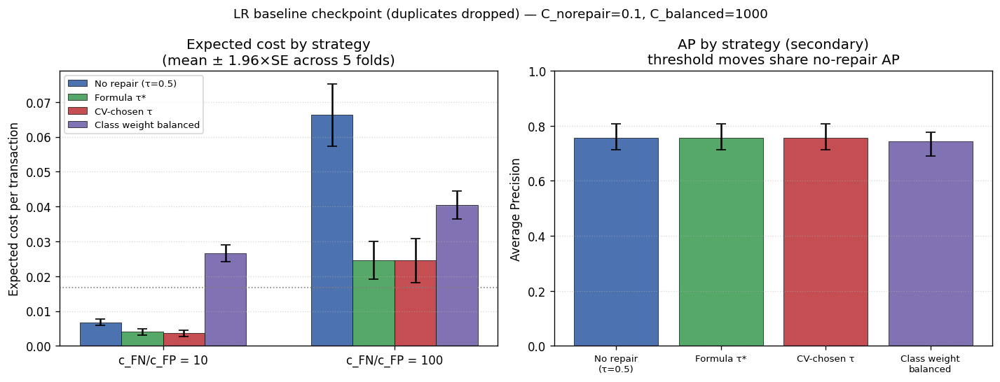

# Fraud Detection Under Severe Class Imbalance

**ESE 5420 Final Project — Topic 21 (A rare positive class)**
Sumit Pradeep Kolpe, Urav Dalal, Mahalakshmi Phaldesai

## Question

Credit-card fraud is extremely rare (0.17% of transactions). For logistic regression, which repair — no repair, a formula cost-sensitive threshold, a CV-chosen threshold, or class weighting — gives the lowest **expected cost** at two frozen cost ratios (`c_FN/c_FP = 10` and `100`)? Average Precision (AP) is reported only as a secondary metric: a moved threshold, or class weights in logistic regression, barely change how scores *rank*, so AP alone cannot distinguish these repairs.

## Data

[OpenML CreditCardFraudDetection (ID 42175)](https://www.openml.org/d/42175) — 284,807 anonymized transactions, 492 labeled fraud (0.173%), 30 numeric inputs (`Time`, `Amount`, `V1`–`V28`). The pipeline fetches and caches this automatically (see Setup below); the raw CSV is **not** committed to this repo.

The raw extract contains **1,081 exact duplicate rows** (1,062 legitimate, 19 fraud) — these are dropped before any split to avoid leaking a duplicated row across train/validation/test (see [`docs/baseline_checkpoint.md`](docs/baseline_checkpoint.md#issues-found)).

## Results (baseline checkpoint — logistic regression)

Mean expected cost per transaction, 5-fold CV, 95% CI from the fold-level standard error:

| Strategy | cost @ r=10 | cost @ r=100 | AP |
|---|---|---|---|
| No repair (τ=0.5) | 0.00677 (0.00555, 0.00799) | 0.06625 (0.05361, 0.07888) | 0.756 |
| Formula τ* | 0.00401 (0.00266, 0.00537) | 0.02454 (0.01694, 0.03214) | 0.756 |
| CV-chosen τ | 0.00360 (0.00235, 0.00485) | 0.02453 (0.01561, 0.03344) | 0.756 |
| Class weight balanced | 0.02659 (0.02311, 0.03007) | 0.04047 (0.03475, 0.04618) | 0.744 |

Naive always-legitimate cost: 0.01665 (r=10), 0.16653 (r=100).

CV-chosen τ and formula τ* are the cheapest at both ratios and are statistically tied with each other at r=100; both beat no-repair and class-weighting. Class weighting over-corrects (high recall, very low precision) and loses badly at r=10. Full table, caveats, and methodology notes: [`docs/baseline_checkpoint.md`](docs/baseline_checkpoint.md).



## Repo layout

```
baseline.py                       # canonical pipeline (run this, or the notebook)
baseline.ipynb                    # same pipeline, notebook form, outputs saved
results/
  baseline.png                    # key figure
  baseline_results.json           # full summary (per strategy: mean/min/max/SE/95% CI)
  baseline_folds.csv              # per-fold raw metrics
docs/
  proposal.md                     # original project proposal
  feedback_and_requirements.md    # instructor feedback -> what changed
  baseline_checkpoint.md          # this checkpoint's write-up (submitted doc)
requirements.txt
```

## Setup

```bash
pip install -r requirements.txt
python baseline.py
```

The first run fetches the dataset from OpenML (ID 42175) and caches it to `data/creditcard.csv` (gitignored); later runs reuse the cache. Outputs land in `results/`.

## Methodology notes

- **Split**: stratified 80/20 train/test, `random_state=42`, seed frozen. The test set is untouched in this checkpoint — only 5-fold CV on the training half is used to select `C` and thresholds.
- **Leakage controls**: `StandardScaler` is fit only inside each CV training fold (via `sklearn.Pipeline`); `Time` is replaced with `Time_of_day = Time % 86400` so a random split can't use absolute position in the two-day source file; exact duplicate rows are dropped before splitting.
- **`C` selection is a near-tie**: mean validation AP is flat for `C >= 0.1`; the argmax has flipped across independent reruns of the identical code (100 → 1 → 0.1 for the no-repair branch). Treat the selected `C` as representative of a tied region, not a uniquely best value.
- Repairs are **not stacked** — no-repair, formula-τ, CV-τ, and class weighting are each evaluated independently at threshold 0.5 (or their own τ), per the course feedback.

## Next milestone (16 November draft)

- `HistGradientBoostingClassifier`, same CV/cost objective, on the deduplicated data.
- Random undersampling inside folds.
- Paired stratified bootstrap (1,000 resamples) on the held-out test set; calibration diagnostics.

## AI usage

Claude was used to refine the research question, explain methods, draft/debug code, and cross-check the analysis (including independently re-running the pipeline and identifying the duplicate-rows issue). All experiments were run and verified by the team; AI was not used as a source of experimental results.
